<a href="#about-me">About</a> &nbsp;|&nbsp;
<a href="#tech-stack">Tech Stack</a> &nbsp;|&nbsp;
<a href="#featured-projects">Projects</a> &nbsp;|&nbsp;
<a href="#experience">Experience</a> &nbsp;|&nbsp;
<a href="#education--certifications">Education</a> &nbsp;|&nbsp;
<a href="#lets-connect">Contact</a>

## About Me

## Tech Stack

## Featured Projects

## Experience

## Education & Certifications

## Let's Connect

 

**Phone:** +91 6381448511 &nbsp;|&nbsp; **Portfolio:** [hariportfolioo.xyz](https://hariportfolioo.xyz) &nbsp;|&nbsp; **LinkedIn:** [linkedin.com/in/hariharan9585b](https://linkedin.com/in/hariharan9585b) &nbsp;|&nbsp; **Email:** [hariharan9585b@gmail.com](mailto:hariharan9585b@gmail.com)

